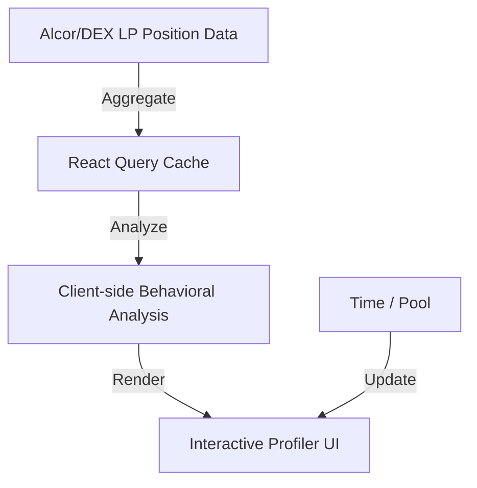

# wax-lp-behavioral-profiler — Liquidity Provider Behavioral Profiler & Visualizer

> **Status:** 🔒 Private (In Development) | Target Public Release: August 2026  
> **Category:** Alcor & DeFi Visualizers  
> **Parent Catalog:** [pixel-journey/wax-ecosystem-blueprint-catalog](https://github.com/pixel-journey/wax-ecosystem-blueprint-catalog)

**One-sentence goal:** A behavioral profiler and visualizer that analyzes liquidity provider activity patterns, contribution quality, risk profiles, and performance metrics with beautiful charts and insights for DeFi on WAX.

---

## 1. Overview & Goal

This blueprint turns LP data into actionable insights. Users can see who provides liquidity, how they behave, and what risks or value they bring.

- **Why it matters for WAX:** Liquidity is the lifeblood of DeFi. Understanding LP behavior helps protocols, LPs, and traders optimize and manage risk.
- **Public infrastructure only:** Alcor or DEX public data for LP positions and activity, client-side analysis and rendering. No custom contracts.
- **Target users:** LPs, protocol teams, analysts, traders monitoring liquidity health.
- **Success metrics:** "See LP behavior profiles and risk signals in <5s", "Beautiful charts with drill-down", "Clear contribution and risk metrics".

---

## 2. Concepts & Inspiration

- **Core concepts:** LPs have patterns: passive vs active, concentration risk, holding periods, rebalancing frequency. Client aggregates and visualizes these behaviors.
- **Pain points:** LP data is often raw or in tables. Users want beautiful, instant insight into behavior and risk.
- **Inspirations:** DeFi analytics dashboards (Dune, DefiLlama), behavioral finance visualizations. Web3: on-chain LP transparency + beautiful viz.
- **Cross-references:** Perfect with other Alcor/DeFi visualizers (royalty pie, market-cap bubble, high-frequency position monitor) and marketplace tools.

---

## 3. Design Specifications (Pixel Journey Standards)

### 3.1 Visual & Interaction Design
- Clean dashboard with main behavioral segments and risk scores.
- Main visual: Interactive charts (distribution, timeline, risk scatter) with drill-down.
- Sidebar: Filters for time, pool, LP size, behavior type.
- Micro-interactions: Hover shows detailed metrics, click expands LP profile.
- Responsive: Excellent on desktop for analysis; mobile-friendly summary cards.

### 3.2 Key Views / Components
- `LPProfilerDashboard.tsx` — Main dashboard with segments and charts.
- `BehaviorChart.tsx` — Interactive charts for patterns and risk.
- `LPProfilePanel.tsx` — Detailed view for selected LP or segment.
- `RiskMetrics.tsx` — Clear risk scores and contribution quality indicators.
- `ExportPanel.tsx` — Export profiles or reports.

### 3.3 Accessibility (A11y) & Inclusive Design
- WCAG 2.2 AA: High contrast charts with patterns, keyboard navigation, screen reader descriptions of metrics.
- Data table fallback for all visualizations.
- Colorblind-safe palettes.

### 3.4 Performance & Optimization Targets
- Efficient data aggregation with caching.
- Fast chart rendering.
- Responsive design with progressive enhancement.

---

## 4. Technical Architecture

### 4.1 Core Tech Stack
- Next.js 15 + TypeScript + Tailwind + shadcn/ui + Recharts
- @tanstack/react-query
- Alcor or DEX public endpoints for LP data
- Client-side behavioral analysis (clustering, metrics)
- date-fns for time handling

### 4.2 Data Flow Diagram


### 4.3 Folder Structure
```
app/
├── (dashboard)/page.tsx
├── components/
│   ├── profiler/
│   │   ├── LPProfilerDashboard.tsx
│   │   └── BehaviorChart.tsx
│   └── profile/
│       └── LPProfilePanel.tsx
├── hooks/useLPProfiler.ts
├── lib/wax/
│   ├── lp-aggregator.ts
│   └── behavior-analyzer.ts
└── types/lp.ts
```

### 4.4 Security & Privacy
- Purely public data. No PII.

---

## 5. Implementation Examples & Code Snippets

**Core LP profiler hook**
```ts
// hooks/useLPProfiler.ts
export function useLPProfiler(timeRange: string) {
  return useQuery({
    queryKey: ['lp-profiler', timeRange],
    queryFn: async () => {
      const data = await fetchLPData(timeRange);
      return analyzeBehaviors(data);
    }
  });
}
```

**Analysis example**
```ts
function analyzeBehaviors(lpData: any) {
  // Cluster by behavior, calculate risk and contribution metrics
  return { segments, riskScores, topLPs };
}
```

---

## 6. Demo & Testing
- Mock data with realistic LP behaviors and risk profiles.
- Live mode with real DEX data.
- Interaction tests: filters, drill-down, export.
- Analysis accuracy tests with labeled examples.

---

## 7. Roadmap
Phases: Data aggregation and behavioral analysis → Dashboard UI with charts → Polish, a11y, export → full documentation.

Future: Predictive risk models, LP alerts, integration with other DeFi visualizers.

---

## 8. Visual References
> Clean DeFi analytics dashboards like Dune or DefiLlama with behavioral depth. Clear segments, risk visuals, professional yet approachable. Reference: high-quality DeFi visualization tools.

---

## 9. Related Blueprints
- Other Alcor & DeFi visualizers (royalty pie, market-cap bubble, high-frequency position monitor).
- Marketplace analytics tools.

---

## 10. License & Credits
MIT. Built for insightful LP behavior analysis on WAX.

**Pixel Journey — Beautiful interfaces for public blockchain data.**
